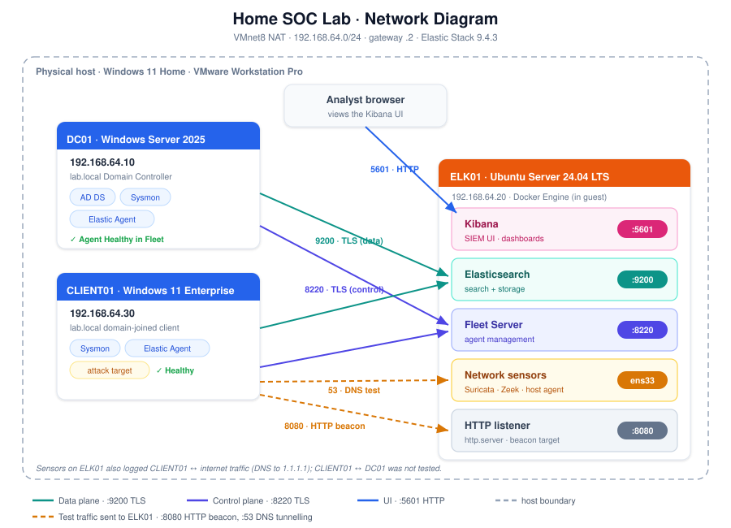
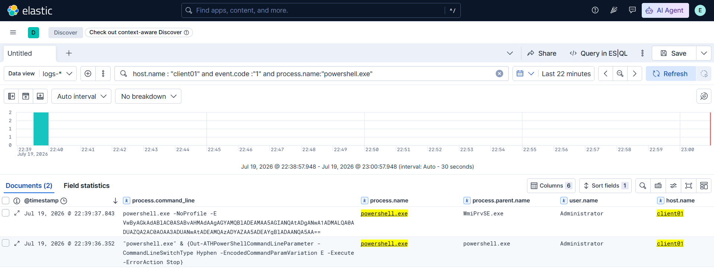
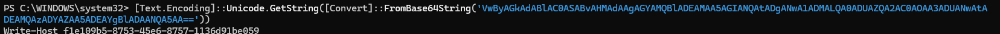
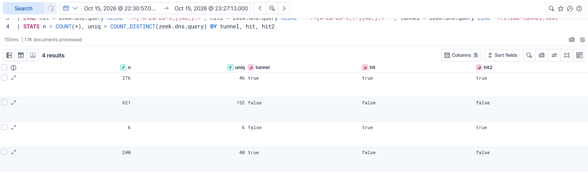
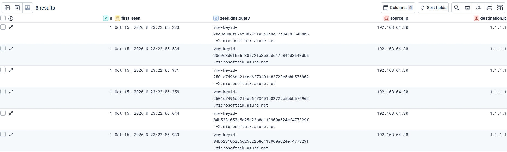
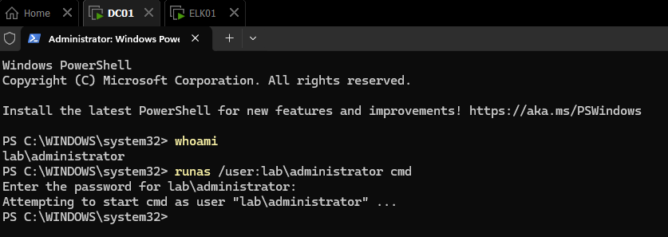
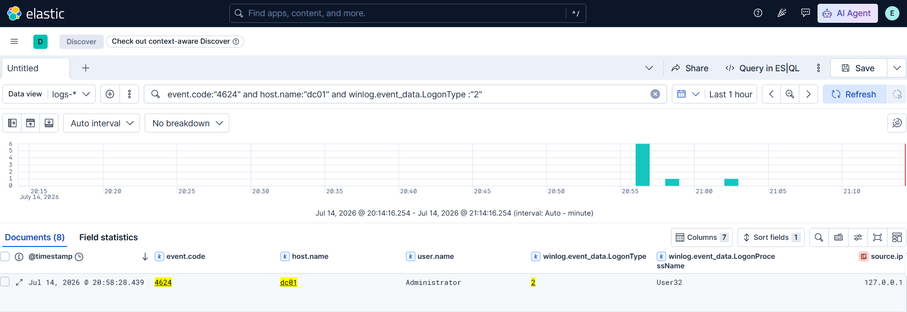
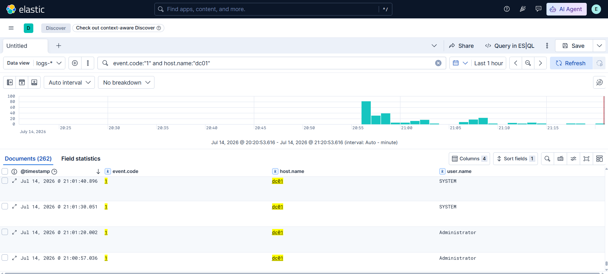
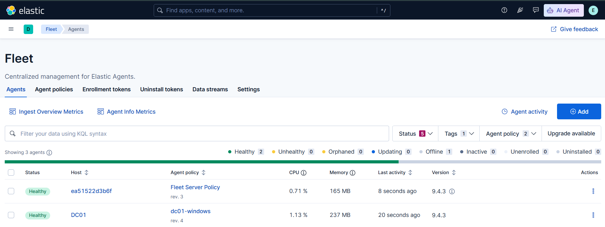

# Project 1 — Attack & Defend: A Home SOC with a Public Detection Portfolio

A small, enterprise-shaped lab where I stand up realistic telemetry, attack the
environment with real adversary tradecraft, and then **detect, triage, and document**
each attack the way a SOC analyst would. This repo is the running record: the build,
the detections, and the incident reports.

It now covers the **lab foundation** (a Windows Active Directory domain and an Elastic
SIEM), a **domain-joined Windows client** wired into the same telemetry pipeline, and
**four detections**: three attacker techniques run against the client and hunted in host
telemetry, then a fourth, command-and-control over HTTP and DNS, hunted in **network
telemetry** from Zeek and Suricata. Each is tuned into a resilient rule where the evidence
allows, and written up as an incident report that says what was and was not tested.

**Write-up:** [Building a home SOC lab, part 1: attacking my own network and writing the detections](https://medium.com/@phoenix01eve/building-a-home-soc-lab-part-1-attacking-my-own-network-and-writing-the-detections-bd22e0ef26a9) (Medium)

---

## What this demonstrates

- Building enterprise-style infrastructure from scratch: a promoted **Active Directory
  domain controller**, a domain-joined **Windows 11 client**, and a single-node
  **Elastic Stack** SIEM.
- Understanding **what a SOC actually sees** — Windows Security event IDs and Sysmon
  process telemetry, plus Zeek and Suricata network telemetry, normalised into Elastic
  Common Schema (ECS).
- Standing up a modern log pipeline with **Fleet-managed Elastic Agent** over TLS,
  including the certificate, encryption-key, and output-trust details that make it work.
- **Detection engineering, not just detection:** running an attack, hunting the telemetry
  it produced, finding where a naive rule *fails*, and tuning it so evasion doesn't slip
  through — then documenting the whole loop as an incident report.
- **Stating limits honestly:** which checks are hunt scripts rather than SIEM rules, which
  thresholds rest on one example, and which conversions have not been tested.
- The discipline that matters day one: **no secrets in the repo**, reproducible builds,
  and evidence-backed documentation.

---

## Detection coverage so far

| Technique | ATT&CK | Rules | Incident report | Gap the attack exposed |
|---|---|---|---|---|
| PowerShell encoded command | T1059.001 | [`T1059.001-powershell-encoded-command.yml`](./detections/T1059.001-powershell-encoded-command.yml) | [IR-2026-001](./incident-reports/T1059.001-powershell-encoded-command.md) | A literal `Encode` match missed the `-E` alias |
| Local account creation | T1136.001 | [`T1136.001-local-account-created-4720.yml`](./detections/T1136.001-local-account-created-4720.yml), [`T1136.001-net-user-add-process.yml`](./detections/T1136.001-net-user-add-process.yml) | [IR-2026-002](./incident-reports/T1136.001-local-account-creation.md) | A process-only rule is blind to `New-LocalUser`; a full-event-chain rule misses a failed attempt |
| Scheduled task persistence | T1053.005 | [`T1053.005-scheduled-task-created-4698.yml`](./detections/T1053.005-scheduled-task-created-4698.yml), [`T1053.005-schtasks-create-process.yml`](./detections/T1053.005-schtasks-create-process.yml) | [IR-2026-003](./incident-reports/T1053.005-scheduled-task-persistence.md) | A `schtasks.exe` process rule is blind to `Register-ScheduledTask`; a converted `contains` query was case-sensitive and missed `/Create` |
| HTTP beaconing (C2) | T1071.001 | [`T1071-beaconing.yml`](./detections/T1071-beaconing.yml) (Sigma), [`T1071-beaconing.rules`](./detections/suricata/T1071-beaconing.rules) (Suricata), [`T1071-beacon-interval.py`](./detections/hunts/T1071-beacon-interval.py) (hunt script) | [IR-2026-004](./incident-reports/IR-2026-004.md) | The signature is defeated by changing the user agent; the interval check is a hunt script, not a SIEM rule, and SSDP multicast was *more* regular than the beacon |
| DNS tunnelling (C2) | T1071.004 | [`T1071.004-dns-tunnelling.yml`](./detections/T1071.004-dns-tunnelling.yml) | [IR-2026-004](./incident-reports/IR-2026-004.md) (section 9) | A 40-character label rule also matched six benign Windows TPM-attestation names whose labels (50 and 53) are longer than my tunnel's (52), so no length threshold separates them; it needed a narrow exclusion and a fan-out check |

> **Validation status.** Rows 1 to 3 were validated by hunting the telemetry in Kibana (the
> converted-query re-tests are tracked in the incident reports). For rows 4 and 5, the Kibana
> and ES|QL queries were tested directly, but the **Sigma-to-Elastic conversion of the
> network rules has not been run**, the DNS rule's exclusion and fan-out hunt are untested over
> the full window, and the thresholds rest on one beacon, two DNS runs and about 158 distinct
> benign names.

The same coverage as an ATT&CK Navigator layer: [`attack-navigator.json`](./attack-navigator.json) (T1071.004 is shaded lighter to show its tuning is partly unvalidated). Load it at [mitre-attack.github.io/attack-navigator](https://mitre-attack.github.io/attack-navigator/) via *Open Existing Layer → Upload from local*.

---

## Architecture at a glance



Three VMs on a single 16 GB laptop, connected over VMware's **VMnet8 NAT** network
(`192.168.64.0/24`, gateway `.2`).

| Host | OS | IP | Role | Status |
|---|---|---|---|---|
| **DC01** | Windows Server 2025 (Desktop Experience) | `192.168.64.10` | `lab.local` Domain Controller (AD DS + DNS); Sysmon; Elastic Agent | Built, promoted, shipping |
| **ELK01** | Ubuntu Server 24.04 LTS | `192.168.64.20` | Elasticsearch + Kibana + Fleet Server (Docker); **Suricata + Zeek network sensors and a host Elastic Agent**; HTTP listener for the beacon test; later, the Linux attack target | Built, verified, healthy |
| **CLIENT01** | Windows 11 Enterprise (eval) | `192.168.64.30` | Domain-joined client and **attack target**; Sysmon; Elastic Agent | Built, instrumented, shipping |

> The lab runs on **VMware Workstation Pro** rather than Hyper-V (the host is Windows 11
> **Home**), which also gives clean **snapshots** — I snapshot a known-good baseline before
> every attack and roll back afterward. Elastic runs in **Docker inside the Ubuntu guest**,
> not Docker Desktop on the host, so the Windows VMs keep VMware's native hypervisor.
>
> **RAM discipline (16 GB):** idle VMs stay powered off. All three run together only during
> an active attack-and-detect cycle; the Elasticsearch JVM heap is capped (~1.5 GB, ample
> for lab volume). The network-telemetry work ran with **ELK01 and CLIENT01 only**; with
> the sensors added, ELK01 (5.7 GiB) was down to about 1.1 GiB available, so it may need
> raising to 7 GB.

---

## Software versions

| Component | Version |
|---|---|
| Hypervisor | VMware Workstation Pro (personal use) |
| Domain Controller | Windows Server 2025 (eval) |
| Windows client | Windows 11 Enterprise (eval) |
| SIEM host | Ubuntu Server 24.04 LTS |
| Elastic Stack (Elasticsearch, Kibana) | **9.4.3** (pinned) |
| Fleet Server / Elastic Agent (including the agent on the ELK01 host, x86_64) | **9.4.3** |
| Endpoint telemetry | Sysmon + SwiftOnSecurity config |
| Network telemetry | Suricata (OISF stable PPA) with the ET Open ruleset (53,159 rules loaded); Zeek (openSUSE Build Service package, JSON logs) |
| Attack simulation | Atomic Red Team; a PowerShell/`curl.exe` beacon loop and a `Resolve-DnsName` loop for the network tests |

---

## How telemetry flows (endpoint → Fleet → Elasticsearch → Kibana)

Each Windows endpoint runs an Elastic Agent that uses two separate TLS connections to ELK01:

- **Control plane — Fleet Server on `:8220` (TLS).** The agent enrolls against Fleet,
  receives its policy, and reports health.
- **Data plane — Elasticsearch on `:9200` (TLS).** The agent ships collected events
  directly into Elasticsearch, into `logs-*` data streams.

Both endpoints carry the same two integrations, on their own policies (`dc01-windows`,
`client01-windows`):

- **System** → Windows Security channel, including logon events such as **`4624`**,
  account creation **`4720`**, and scheduled-task creation **`4698`**.
- **Windows** → the `sysmon_operational` channel, including Sysmon **EID 1** (process create).

**Network telemetry** uses the same pipeline from a different source: Suricata
(`eve.json`) and Zeek (JSON logs) run on ELK01 and watch its `ens33` interface, and an
**Elastic Agent on the ELK01 host** (policy `elk01-network`, Zeek and Suricata
integrations) ships them as the datasets `zeek.connection`, `zeek.http`, `zeek.dns` and
`suricata.eve`. On this VMware NAT setup the sensor also saw CLIENT01's traffic to the
internet, which it was not party to; CLIENT01-to-DC01 traffic was **not** tested, so the
tests send traffic *to* ELK01 to stay reproducible.

Analysis happens in the browser against **Kibana on `:5601`** (plain HTTP is fine on the
private NAT). X-Pack security + TLS are enabled throughout — not decoration, but a hard
requirement for Fleet to function.

---

## First detection: T1059.001 PowerShell encoded command

Week 3 closes the full loop — **attack → log → detect → tune → document**. I ran an
Atomic Red Team test for **T1059.001 (Command and Scripting Interpreter: PowerShell)**
against CLIENT01: PowerShell launched with an *encoded command* switch, the classic
obfuscation trick that hides what actually ran inside a Base64 blob.

**The detection, and the gap it exposed.** My first hunt filtered the command line on the
literal string `Encode` — and missed the real event. The atomic launched PowerShell using
the single-letter alias **`-E`** (a valid abbreviation of `-EncodedCommand`), which never
contains the string "Encode." A rule written against the full switch name is blind to it.
Broadening the hunt revealed the true event: `powershell.exe -NoProfile -E <base64>`,
spawned by **`WmiPrvSE.exe`** (i.e. via WMI).



Decoding the Base64 (PowerShell uses UTF-16LE) resolved it to a benign marker the atomic
writes to prove execution — confirming this as controlled test activity:



**The fix.** The Sigma rule was rewritten from a literal string match to an **alias-aware
regex** that matches `-e` followed by any valid prefix of `ncodedcommand` (`-e`, `-en`,
`-enc`, `-ec` … `-EncodedCommand`, case-insensitive), plus a **behavioural backstop** that
flags PowerShell whose parent is `WmiPrvSE.exe` regardless of how the switch is spelled.
That tuning — closing an evasion gap I found by attacking my own lab — is the point of the
exercise, and exactly the reasoning a SOC role probes for.

- **Detection rule:** [`detections/T1059.001-powershell-encoded-command.yml`](./detections/T1059.001-powershell-encoded-command.yml)
- **Incident report:** [`incident-reports/T1059.001-powershell-encoded-command.md`](./incident-reports/T1059.001-powershell-encoded-command.md)

---

## Second detection: T1136.001 local account creation

Persistence by creating a new local account (**T1136.001**). I ran two Atomic Red Team
tests against CLIENT01 as the same administrator session: `net user /add` (test 4) and
`New-LocalUser` (test 5). The telemetry told a more interesting story than "account created":

- **The first `net user /add` failed.** The atomic's default password contains the
  username, so Windows rejected it on complexity. It still left evidence: a Security
  **`4720`** (account created) followed **5 ms later** by a **`4726`** (account deleted),
  plus the `net.exe` / `net1.exe` process-creates in Sysmon. A rule that waits for the full
  `4720 → 4722 → 4738` chain would never fire on it.
- **The PowerShell route spawned no `net.exe` at all.** `New-LocalUser` produced `4720`,
  `4722` and `4738` but no `net … /add` process, so a Sysmon-only rule is blind to it.
- **Only the `net user` route produced `4724`** (password reset), and only it exposed the
  password, in cleartext, in `process.command_line`.
- **Command lines are logged with a double space** (`net  user /add`) when launched from
  cmd.exe, so a literal `net user /add` match would be fragile.


**The result is a pair of rules, each covering what the other can't:**

- **Security `4720`** is the primary rule: it fires for `net user`, `New-LocalUser` and failed
  attempts alike (machine accounts excluded).
- **Process creation** (`net.exe`/`net1.exe` with `user` and `/add` as separate,
  whitespace-tolerant terms) adds the actor's intent, parent process and any cleartext password.

- **Detection rules:** [`4720`](./detections/T1136.001-local-account-created-4720.yml), [`net user /add`](./detections/T1136.001-net-user-add-process.yml)
- **Incident report:** [`incident-reports/T1136.001-local-account-creation.md`](./incident-reports/T1136.001-local-account-creation.md)

---

## Third detection: T1053.005 scheduled task persistence

Persistence through a scheduled task (**T1053.005**). I ran two Atomic Red Team tests
against CLIENT01 from the same administrator session: `schtasks.exe /Create` (test 2) and
the PowerShell `Register-ScheduledTask` cmdlet (test 4). Again the telemetry was more
interesting than "task created":

- **Security `4698` fired for both routes**, but carries no process or command line. I link
  it to the process event by logon session and timestamp (60 ms after `schtasks.exe` for
  test 2).
- **The Sysmon `schtasks.exe` hunt returned one event, for test 2 only.** The cmdlet route
  never launches `schtasks.exe`, so a process-only rule is blind to it.
- **The PowerShell process event did carry `Register-ScheduledTask`**, but only because
  the atomic passes the script inline. A `.ps1` file would not show it, and PowerShell
  Script Block Logging (4104) is not collected yet: a coverage gap recorded in the report.
- **The `4698` task content showed the persistence intent:** a logon trigger running
  `calc.exe` as the Administrators group with the highest run level.
- **A converted query failed silently on case.** Sigma's `contains` is case-insensitive,
  but the Lucene conversion was case-sensitive on `process.command_line`: `*/create*`
  found nothing while `*/Create*` found the event. The process rule should be converted
  with the EQL backend (`like~`, case-insensitive) instead.


**Two rules, each covering what the other can't:**

- **Security `4698`** is the primary rule: it fires for `schtasks.exe` and cmdlet routes alike.
- **Process creation** (`schtasks.exe` with `/create`) adds the task name, action, parent
  process and actor from the command line.

- **Detection rules:** [`4698`](./detections/T1053.005-scheduled-task-created-4698.yml), [`schtasks /create`](./detections/T1053.005-schtasks-create-process.yml)
- **Incident report:** [`incident-reports/T1053.005-scheduled-task-persistence.md`](./incident-reports/T1053.005-scheduled-task-persistence.md)

---

## Fourth detection: T1071 command and control in network telemetry

Everything above was host telemetry. Investigating an earlier scenario showed me the blind
spot: strong endpoint logs, no network logs. So I put **Suricata and Zeek on ELK01**, shipped
them through Fleet, and simulated two command-and-control patterns from CLIENT01.

**HTTP beaconing (T1071.001).** A PowerShell loop called an HTTP listener on ELK01 about
every 60 seconds (±5 s jitter, 30 requests) with a fixed user agent.

- **Both sensors saw all 30 flows:** 30 Suricata alerts (a custom rule on the user agent),
  30 `zeek.connection` rows and 30 `zeek.http` rows.
- **The signature is the naive version.** Change the user agent and both the Suricata rule
  and the Zeek HTTP query go blind.
- **The behavioural check is a hunt script, not a SIEM rule.** It groups Zeek `conn.log`
  by source, destination and port and computes the coefficient of variation (sd / mean)
  of inter-arrival times. Sigma and KQL cannot compute a standard deviation, so I say so
  rather than imply an in-SIEM detection.
- **Low variance alone is not a detector.** The beacon scored cv 0.06; SSDP multicast
  scored 0.00 (*more* regular), while the Elastic Agent scored 0.61 and DNS 1.42 to 2.96.
  The rule needs a minimum count (10), a multicast exclusion and an allowlist. That
  threshold rests on **one beacon and five baseline pairs**: supported, not proven.


**DNS tunnelling (T1071.004).** Two runs of 40 queries with long random labels to a
non-resolving test domain, sent to ELK01. Both sensors logged every query (240 rows each
for 40 names, about six rows per name, which fits Windows retries).

- **I found my own generator bug.** `Get-Random -Count 52` on a 36-character pool returns
  at most 36 values, so run 1 had 36-character labels. Run 2 used sampling with
  replacement and measured exactly 52. Run 1 is kept in the record.
- **Total query length was useless:** a benign Windows DC-locator name (72 characters) was
  longer than the tunnel's 70. I then wrote a rule on a single label of 40 or more
  characters.
- **That rule broke on a larger baseline.** Over about an hour it matched six benign names
  (`vmw-keyid-<40 hex>[-v2].microsoftaik.azure.net`, which look like Windows TPM attestation
  lookups). Their labels are 50 and 53 characters and the tunnel's is 52, so **no length
  threshold separates them**. Six of 158 distinct benign names matched. My first 5-minute
  baseline had missed them.
- **The fix is tuning, not a cleaner threshold:** an exclusion for the exact parent
  `.microsoftaik.azure.net`, plus a fan-out hunt (30 or more distinct names under one parent
  in 5 minutes; 6 benign against 40 for the tunnel). The fan-out threshold is a judgement
  inside a gap and has not been re-checked over the full window.
- **A tooling gotcha worth knowing:** ES|QL `RLIKE` rejects a trailing hyphen in a
  character class (`[A-Za-z0-9_-]`). A Python test passes it, so test regexes in the target
  engine.
- **Not used:** entropy. Both generators emit uniform-random labels, so a threshold would be
  tuned on an artefact.





- **Detection rules:** [`T1071-beaconing.yml`](./detections/T1071-beaconing.yml), [`T1071-beaconing.rules`](./detections/suricata/T1071-beaconing.rules), [`T1071.004-dns-tunnelling.yml`](./detections/T1071.004-dns-tunnelling.yml)
- **Hunt script:** [`detections/hunts/T1071-beacon-interval.py`](./detections/hunts/T1071-beacon-interval.py)
- **Incident report:** [`incident-reports/IR-2026-004.md`](./incident-reports/IR-2026-004.md)
- **Build and gotchas:** [`docs/06-network-telemetry-elk01.md`](./docs/06-network-telemetry-elk01.md)

**Limits, stated up front:** the Sigma-to-Elastic conversion of both network rules is
untested; the exclusion and the full-window fan-out check are untested; the tunnel queries
went straight to ELK01 rather than through a resolver; the benign sample is one small
environment; and six extra tunnel-domain names seen a few minutes before run 2 are
unexplained.

---

## Reproduce it yourself

The full, step-by-step build lives in `docs/`:

1. **[`docs/01-lab-build-elk01.md`](./docs/01-lab-build-elk01.md)** — build ELK01: Ubuntu
   VM → Docker Engine → single-node Elastic Stack 9.4.3 (security + TLS, heap-capped) →
   verify Kibana loads.
2. **[`docs/02-sysmon-dc01.md`](./docs/02-sysmon-dc01.md)** — install Sysmon on DC01 with
   the SwiftOnSecurity config and confirm EID 1 in `Microsoft-Windows-Sysmon/Operational`.
3. **[`docs/03-fleet-dc01.md`](./docs/03-fleet-dc01.md)** — add Fleet Server to the compose
   stack and enroll the Elastic Agent on DC01. Includes an interview-ready **"Gotchas"**
   section (cert SANs for the ELK IP, absolute cert paths, Kibana encryption keys, and
   making the Fleet default output trust the lab CA).
4. **[`docs/04-client01-build.md`](./docs/04-client01-build.md)** — build and domain-join
   CLIENT01, install Sysmon, enroll the Elastic Agent, and verify its telemetry
   (`4624` + Sysmon EID 1 for `host.name:"client01"`). Includes a **"Gotchas"** section
   (clock-skew → Kerberos, DNS fail-over with the DC off, large agent-zip download,
   headless-ELK01 CA transfer via `scp`).
5. **[`docs/06-network-telemetry-elk01.md`](./docs/06-network-telemetry-elk01.md)** — install
   Suricata and Zeek on ELK01, enroll a host Elastic Agent on a new policy, and run the
   beacon and DNS-tunnelling tests. Includes **"Gotchas"** (wrong-architecture agent
   download, Zeek checksum offload on a VMware guest, the dpkg lock, the ES|QL regex
   hyphen, and the baseline that missed a benign family).

The Docker starter kit is in **[`elk/`](./elk/)**: `docker-compose.yml`, `.env.example`,
`bring-up.sh`, and `verify.sh`. Copy `.env.example` to `.env`, fill in your own values,
then bring the stack up.

**Prerequisites:** a host with hardware virtualisation enabled, ~16 GB RAM (practical
floor — keep idle VMs powered off), and ~80 GB free disk (use thin-provisioned disks).

> For live endpoint telemetry, ELK01 plus the endpoint you're working with must be running
> together. For an attack-and-detect cycle, that's **CLIENT01 + ELK01**; DC01 only needs to
> be up when a technique touches the domain.

---

## Verifying the pipeline: from action to searchable event

The lab-foundation milestone was proving I can see my own activity as SOC telemetry. I
traced a single action end to end — from the command that caused it to the event in the SIEM.

**1. Generate a logon on DC01.** From an elevated PowerShell I confirmed my identity and
forced a fresh interactive logon:



`runas /user:lab\administrator cmd` triggers a Windows Security **event 4624** (an account
was successfully logged on), **Logon Type 2** (interactive).

**2. Find it in Kibana.** Seconds later the event is in Discover (`logs-*`):

```
event.code : "4624" and host.name : "dc01" and winlog.event_data.LogonType : "2"
```



The event at **20:58:28** matches the `runas` above: account `Administrator`,
`LogonType 2` (interactive), `LogonProcessName User32`, `source.ip 127.0.0.1` (a local
logon). That timestamp-and-attribute match is the whole point of the milestone — my action
on DC01 became a queryable event in the SIEM within seconds.

**3. Sysmon telemetry in parallel.** The Windows integration also ships Sysmon, so the same
host produces process-level telemetry. Here are Sysmon **EID 1** (process create) events
from DC01:

```
event.code : "1" and host.name : "dc01"
```



**Pipeline health.** Both the Fleet Server agent and the DC01 agent (policy `dc01-windows`)
report **Healthy** in Fleet, on Stack 9.4.3:



Together this confirms endpoint (Sysmon EID 1) **and** security (Windows 4624) telemetry
flowing over a healthy, Fleet-managed, TLS pipeline — I can see the lab. CLIENT01 was later
brought onto the same pipeline (`client01-windows`) and verified the same way, which is what
made the detections above possible.

---

## Secrets & safety

No credentials or secrets are committed. The repo `.gitignore` excludes `.env`, the
generated Fleet **service token**, the Kibana **encryption keys**, and all **TLS certs**
and stack data. Passwords (Administrator, DSRM, `elastic` / `kibana_system`) are recorded
**outside** this repo. `.env.example` documents the required variables with placeholder
values only. Test-account passwords shown in incident reports are throwaway, lab-only values.
Fleet enrollment tokens are cropped out of screenshots.

---

## Repo layout

```
project-1-home-soc/
├── README.md                     # this file
├── attack-navigator.json         # ATT&CK Navigator coverage layer
├── docs/
│   ├── 01-lab-build-elk01.md     # ELK01 build walkthrough
│   ├── 02-sysmon-dc01.md         # Sysmon install + verification
│   ├── 03-fleet-dc01.md          # Fleet Server + DC01 agent enrollment (+ Gotchas)
│   ├── 04-client01-build.md      # CLIENT01 build, domain-join, instrument (+ Gotchas)
│   ├── 06-network-telemetry-elk01.md  # Zeek + Suricata on ELK01, beacon + DNS tests (+ Gotchas)
│   ├── network-diagram.svg       # lab network diagram (sensors, listener, test flows)
│   └── img/
│       ├── cmd-runas-dc01.png                    # the action: runas on DC01
│       ├── 4624-kibana-discover.png              # the result: 4624 logon in Kibana
│       ├── 1-kibana-discover-sysmon.png          # Sysmon EID 1 in Kibana
│       ├── healthy-fleet-dc01-elk01.png          # DC01 agent Healthy in Fleet
│       ├── healthy-fleet-client01-elk01.png      # CLIENT01 agent Healthy in Fleet
│       ├── 4624-kibana-discover-Client01.png     # CLIENT01 4624 (cached logon)
│       ├── Sysmon-EID1-Client01.jpg              # CLIENT01 Sysmon EID 1
│       ├── cmd-runas&ping-client01.png           # CLIENT01 verification marker
│       ├── T1059.001-discover-child-process.png  # detected encoded PowerShell (WMI parent)
│       ├── T1059.001-decoded-payload.png         # decoded benign marker
│       ├── T1136.001-4720-three-events.png       # three 4720s with actor + logon session
│       ├── T1136.001-account-lifecycle-1.png     # PowerShell route: 4720/4722/4738
│       ├── T1136.001-account-lifecycle-2.png     # net user route: adds 4724
│       ├── T1136.001-4726-deletions.png          # rollback + cleanup deletions
│       ├── T1136.001-sysmon-net-add.png          # net user /add process creation
│       ├── T1053.005-task-creation.png           # 4698 for the schtasks and cmdlet routes
│       ├── T1053.005-task-lifecycle.png          # task lifecycle query, 4702 noise
│       ├── T1053.005-sysmon-test2.png            # schtasks /Create process creation
│       ├── T1053.005-sysmon-test4.png            # Register-ScheduledTask command line
│       ├── T1053.005-case-sensitivity-test.png   # */create* vs */Create* result
│       ├── T1053.005-sysmon-test2-cleanup.png    # cleanup: schtasks /Delete
│       ├── T1053.005-sysmon-test4-cleanup.png    # cleanup: Unregister-ScheduledTask
│       ├── T1053.005-powershell.png              # cleanup run + empty Get-ScheduledTask
│       ├── T1071-suricata-alert.png              # Suricata alerts for the 30-request beacon
│       ├── T1071-suricata-alert-first-test.png   # first single test request, rule check
│       ├── T1071-zeek-conn.png                   # Zeek conn rows for the beacon
│       ├── T1071-zeek-http.png                   # Zeek http rows by user agent
│       ├── T1071-interval-stddev.png             # interval hunt script output
│       ├── fleet-elk01-network-healthy.png       # elk01-network agent Healthy in Fleet
│       ├── T1071.004-dns-long-labels.png         # Zeek DNS, run 1
│       ├── T1071.004-suricata-dns.png            # Suricata DNS rrname, run 1
│       ├── T1071.004-dns-baseline.png            # 5-minute fan-out baseline
│       ├── T1071.004-run2-label-lengths.png      # run 2: label 52, total 70
│       ├── T1071.004-regex-test.png              # regex test over both runs
│       └── T1071.004-benign-tpm-lookups.png      # the six benign matches
├── elk/
│   ├── docker-compose.yml        # Elasticsearch + Kibana + Fleet Server
│   ├── .env.example              # required variables (no secrets)
│   ├── bring-up.sh
│   └── verify.sh
├── detections/                   # Sigma rules
│   ├── T1059.001-powershell-encoded-command.yml
│   ├── T1136.001-local-account-created-4720.yml
│   ├── T1136.001-net-user-add-process.yml
│   ├── T1053.005-scheduled-task-created-4698.yml
│   ├── T1053.005-schtasks-create-process.yml
│   ├── T1071-beaconing.yml
│   ├── T1071.004-dns-tunnelling.yml
│   ├── suricata/
│   │   └── T1071-beaconing.rules             # native Suricata rule (sid 1000001)
│   └── hunts/
│       └── T1071-beacon-interval.py          # interval-regularity hunt script
└── incident-reports/             # one-page reports per attack
    ├── T1059.001-powershell-encoded-command.md
    ├── T1136.001-local-account-creation.md
    ├── T1053.005-scheduled-task-persistence.md
    └── IR-2026-004.md            # T1071.001 beaconing + T1071.004 DNS tunnelling
```

---

## Status & roadmap

**Weeks 1–2 — Stand up the lab and prove you can see.** ✅ Complete.

- [x] VMware Workstation Pro installed; virtualisation confirmed
- [x] DC01 built, promoted to `lab.local` (`Get-ADDomain` verified)
- [x] ELK01 built; Elastic Stack 9.4.3 deployed (security + TLS, heap-capped)
- [x] Sysmon installed on DC01 (SwiftOnSecurity config); EID 1 verified
- [x] Fleet Server stood up; Elastic Agent enrolled on DC01 (Healthy)
- [x] Own `4624` logon traced from `runas` to Kibana; README, diagram, and screenshots committed

**Week 3 — CLIENT01 as a target, and first detections.** ✅ Complete (3 of 3 detections done, write-up published).

- [x] CLIENT01 built, domain-joined `lab.local`, Sysmon + Elastic Agent enrolled (Healthy); `4624` + Sysmon EID 1 verified for `host.name:"client01"`
- [x] Atomic Red Team installed on CLIENT01; clean pre-attack snapshot taken
- [x] **T1059.001** (encoded PowerShell) — detected, decoded, rule tuned for the `-E` alias gap, incident report written
- [x] **T1136.001** (local account creation) — detected via Security `4720` + Sysmon `net … /add`; failed attempt and PowerShell route both analysed; incident report written
- [x] **T1053.005** (scheduled task) — detected via Security `4698` (both the `schtasks.exe` and PowerShell cmdlet routes) + Sysmon `schtasks /create`; incident report written
- [x] ATT&CK coverage layer ([`attack-navigator.json`](./attack-navigator.json))
- [x] Blog post #1: [Building a home SOC lab, part 1](https://medium.com/@phoenix01eve/building-a-home-soc-lab-part-1-attacking-my-own-network-and-writing-the-detections-bd22e0ef26a9)

**Network telemetry — Zeek + Suricata on ELK01.** ✅ Built and tested; some checks still open.

- [x] Suricata and Zeek installed on ELK01; host Elastic Agent on policy `elk01-network` (Healthy); datasets `zeek.connection`, `zeek.http`, `zeek.dns`, `suricata.eve` arriving
- [x] **T1071.001** (HTTP beaconing) — 30-request beacon detected 30/30 by Suricata, Zeek conn and Zeek http; interval hunt script separates it from other regular traffic (cv 0.06); incident report written
- [x] **T1071.004** (DNS tunnelling) — two runs logged by both sensors; label-length rule written, found to match a benign family, tuned with an exclusion and a fan-out hunt; incident report section written
- [x] Network diagram updated (sensors, listener, test flows)
- [ ] Run `sigma convert` on both network rules and test the converted queries in Kibana
- [ ] Re-run the DNS fan-out hunt over the full window and test the exclusion
- [ ] Re-run the interval hunt script with its flag logic (added after the run, never executed)
- [ ] Test CLIENT01-to-DC01 visibility on the sensor (DC01 was off)

**Later weeks:** real Active Directory tradecraft (Kerberoasting, AS-REP roasting, password
spraying), credential dumping, then a coverage dashboard and packaging.
