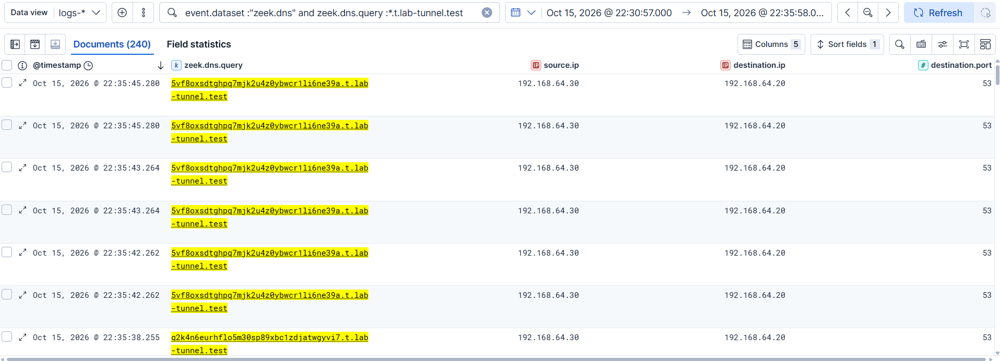
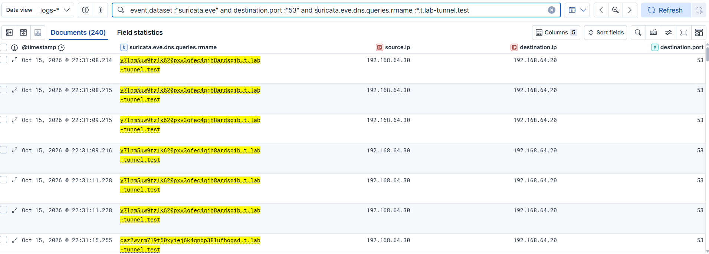

# Incident Report: T1071.001 Simulated C2 Beaconing and T1071.004 DNS Tunnelling

| | |
|---|---|
| **Report ID** | IR-2026-004 |
| **Date of activity** | 2026-10-15 |
| **Analyst** | Karthik S |
| **Host** | CLIENT01 (`192.168.64.30`), Windows 11 Enterprise, domain `lab.local`; listener and sensors on ELK01 (`192.168.64.20`) |
| **Source** | Controlled test: PowerShell/`curl.exe` loop, 30 requests at ~60 s with ±5 s jitter, fixed user agent `LabBeacon/1.0`; DNS tunnelling: two runs of 40 queries each to a non-resolving test domain, sent directly to ELK01 |
| **Severity** | Medium (as a real beacon would be; this was test activity) |
| **Status** | Both halves detected and written up. Sigma-to-Elastic conversion of both network rules: **untested** (the Kibana and ES\|QL queries were tested directly). The DNS rule's regex was tested in ES\|QL; its benign-family exclusion and the fan-out hunt over the full window were not |

## 1. Summary

CLIENT01 sent 30 HTTP requests to a listener on ELK01 (`192.168.64.20:8080`) at roughly 60-second intervals with small jitter, simulating a low-sophistication command-and-control beacon (T1071.001). Both network sensors on ELK01, Suricata and Zeek, recorded all 30 flows, and a custom Suricata rule alerted on every one. A separate interval-regularity analysis of Zeek `conn.log` isolated the beacon from the other regular traffic in the lab. A second test simulated DNS tunnelling (T1071.004): two runs of 40 long-label queries, both logged by both sensors. A length-based rule matched the tunnel and also six benign Windows TPM attestation lookups, so it needed a narrow exclusion; section 9 has the detail. This was controlled test activity, not a live intrusion.

## 2. ATT&CK mapping

- **Tactic:** Command and Control (TA0011)
- **Technique:** T1071.001, Application Layer Protocol: Web Protocols
- **Technique:** T1071.004, Application Layer Protocol: DNS (section 9)

## 3. Timeline

All times UTC (Kibana displayed BST, UTC+1, in the screenshots; subtract one hour).

| Time (UTC) | Source | Event | Detail |
|---|---|---|---|
| 14:40:51 | Suricata | First single test request; alert `1000001` | Rule verified (my own test traffic) |
| 15:01:04, 15:07:25, 15:09:56 | Suricata / Zeek | Three further single test requests | My own traffic; the 15:09:56 flow was the first to log as `SF` after the checksum fix. Excluded from beacon statistics |
| 15:57:26 | Analyst | Beacon loop started on CLIENT01 | `Get-Date`: 16:57:26 BST |
| 15:57:26 to 16:26:39 | Suricata, Zeek | 30 requests to `192.168.64.20:8080` | 30 Suricata alerts, 30 `zeek.connection` rows, 30 `zeek.http` rows; the last beat (16:26:39) is logged by Suricata and Zeek 2 ms apart |
| 16:27:33 | Analyst | Loop finished | `Get-Date`: 17:27:33 BST |
| 21:30:57.95 to 21:35:57.13 | Analyst, Zeek, Suricata | DNS run 1: 40 queries to `<label>.t.lab-tunnel.test` via ELK01 | Labels were 36 characters (generator bug). 240 rows on each sensor, 40 distinct names |
| about 22:19 | Zeek | Six further names under `.t.lab-tunnel.test` (36 rows) | Cause not established; before run 2 |
| 22:22:05 to 22:22:07 | Zeek | Six benign `vmw-keyid-...microsoftaik.azure.net` lookups, CLIENT01 to `1.1.1.1` | Matched the length rule; found later (section 9) |
| 22:22:29.73 to 22:27:12.03 | Analyst, Zeek | DNS run 2: 40 queries, 52-character labels | 240 rows, 40 distinct names, total length 70 |

## 4. Detection

**Telemetry sources:** Suricata (`eve.json`) and Zeek (`conn.log`, `http.log`) running on ELK01, shipped by an Elastic Agent on policy `elk01-network` into `logs-*`.

**Portfolio detections:**
- `detections/T1071-beaconing.yml`: Sigma rule for the user-agent signature, with the behavioural logic documented in its comments.
- `detections/suricata/T1071-beaconing.rules`: the native Suricata rule (`sid:1000001`).
- `detections/hunts/T1071-beacon-interval.py`: the interval-regularity hunt script.
- `detections/T1071.004-dns-tunnelling.yml`: Sigma rule for a label of 40 or more characters with an exclusion for `.microsoftaik.azure.net`, plus the fan-out hunt query in its comments (section 9).

**Validated queries (KQL, window 16:57-17:27 BST, 30 results each):**

```
event.dataset : "suricata.eve" and destination.port : 8080 and event.kind : "alert"
event.dataset : "zeek.connection" and destination.port : 8080
event.dataset : "zeek.http" and user_agent.original : "LabBeacon/1.0"
```

**Behavioural detection (hunt script over Zeek `conn.log`):** group connections by source, destination and destination port; for pairs with at least 10 connections compute the mean and population standard deviation of inter-arrival times; flag a coefficient of variation (sd / mean) below 0.2, excluding multicast destinations.

| Pair | n | mean (s) | sd (s) | cv | Identity |
|---|---|---|---|---|---|
| `192.168.64.30` to `192.168.64.20:8080` | 30 | 60.4 | 3.5 | **0.06** | simulated beacon |
| `192.168.64.1` to `239.255.255.250:1900` | 16 | 120.0 | 0.0 | 0.00 | SSDP discovery (likely the host's VMnet8 adapter; **not verified**) |
| `192.168.64.30` to `192.168.64.20:9200` | 375 | 5.0 | 3.1 | 0.61 | Elastic Agent data plane |
| `192.168.64.20` to `1.1.1.1:53` | 18 | 93.6 | 133.2 | 1.42 | DNS |
| `192.168.64.30` to `1.1.1.1:53` | 130 | 14.3 | 42.2 | 2.96 | DNS |
| `192.168.64.20` to `34.95.113.255:443` | 10 | 166.7 | 146.0 | 0.88 | not identified |

**Findings worth recording:**
- **The signature is the naive version.** Any operator who changes the user agent defeats the Suricata rule and the Zeek HTTP query. The interval analysis does not depend on it.
- **Low variance alone is not a detection.** The SSDP multicast traffic was more regular than the beacon (cv 0.00). A threshold-only rule would have flagged it first; the multicast exclusion and a minimum count are required.
- **The interval check is a hunt script, not a SIEM rule.** Sigma has no standard-deviation or inter-arrival aggregation, and the KQL used here cannot compute one. This is stated deliberately so the portfolio does not imply an in-SIEM detection that does not exist.
- **The 0.2 threshold is supported, not proven.** It rests on one beacon and five baseline pairs. Higher-jitter beacons need a looser threshold and will cost more false positives.
- **Internal destinations were not excluded** because the listener is on the internal network. A production rule would concentrate on external destinations.
- **The Sigma rule uses Zeek's native field name** (`user_agent`); in Elastic the field is `user_agent.original`. No sigma-cli conversion has been run, so the mapping is unverified. The Kibana query above is what was tested.
- **The sensor saw traffic ELK01 was not party to** (CLIENT01 to `173.46.83.203:80` and to `1.1.1.1:53`), confirmed with `tcpdump` on `ens33`. VMnet8 delivers other VMs' traffic to ELK01, so this sensor placement works on this setup. CLIENT01 to DC01 traffic was **not** tested.
- **Sensor gotcha (Zeek on a VMware guest):** flows from ELK01 itself were logged with `conn_state` `SH`/`OTH`, one reply packet and `resp_bytes: 0`, because of NIC checksum offload. The `history` field showed lowercase/uppercase `c`. `redef ignore_checksums = T;` fixed it (after: `SF`, `resp_bytes: 202`, 5 packets each way). A `grep` for `bad_checksum` returned 0 because Zeek names these weirds by protocol; the fix was judged by the before/after rows, and I did not capture the `weird.log` entries. This is a deliberate lab trade-off.
- **Unexplained:** before the run, Kibana showed 1 `zeek.connection` row for `:8080` against 4 Suricata alerts. The run itself matched 30 to 30. Cause not established.

## 5. IOCs

> Lab/test artifacts from a controlled simulation.

- **Source:** CLIENT01, `192.168.64.30`
- **Destination:** `192.168.64.20:8080/tcp` (ELK01 listener, Python `http.server`)
- **User agent:** `LabBeacon/1.0`
- **Path:** `/beacon`
- **Behaviour:** ~60 s interval, ±5 s jitter, 30 requests over about 30 minutes
- **DNS test:** parent domain `t.lab-tunnel.test` (non-resolving), queries sent to `192.168.64.20:53/udp`, random 36-character (run 1) and 52-character (run 2) labels
- **Not captured:** the process on CLIENT01 that made the requests (see section 7)

## 6. False-positive analysis

- **Regular benign traffic exists and some of it is more regular than a beacon.** SSDP multicast (cv 0.00) is the clearest example. Tuning: require at least 10 connections, apply the cv threshold, exclude multicast (224.0.0.0/4).
- **Agent and DNS traffic scored far above the threshold** (cv 0.61 to 2.96), so they do not trigger. That is a statement about this lab's traffic, not a guarantee.
- **Real estates add more periodic traffic:** NTP, update checks, EDR and monitoring agents, and software with fixed polling. An allowlist of known-benign destinations is needed before alerting, and the baseline must be built per environment.
- **Signature rule:** low false-positive risk in this lab, but also low value: it only catches this exact string.
- **Not tested:** longer windows, beacons with higher jitter, beacons over HTTPS (the HTTP signature would not see the user agent at all; the interval analysis would still apply to the connection metadata).
- **DNS:** the false-positive analysis is in section 9. In short, a 40-character label rule matched six benign TPM attestation names (labels of 50 and 53 characters, longer than the tunnel's 52), so length alone cannot separate them.

## 7. Containment & remediation

In a real incident an analyst would:

- **Identify the process** on CLIENT01 making the connections (Sysmon process and network events, parent chain) and preserve it.
- **Isolate the host** and **block the destination** at the firewall; check whether other hosts talk to the same destination or use the same user agent.
- **Scope the intrusion:** how the beacon got there (initial access, persistence such as the scheduled-task and account techniques in IR-2026-002 and IR-2026-003), and which accounts were active on the host.
- **Reset credentials** used on the host if compromise is confirmed.
- **Preventive hardening:** egress filtering and proxying so that unexpected destinations are blocked or logged, and continued collection of both host and network telemetry.

## 8. Evidence

**Suricata alerts for the beacon run** (30 results, source and destination visible):


**Zeek connection rows for the same flows** (30 results):


**Zeek HTTP rows matching the user agent** (30 results):


**Interval statistics across all pairs with at least 10 connections:**


**First single test request, rule verification:**


**Sensor policy healthy in Fleet:**


> Image names and extensions assumed (`.png`); confirm exact filenames before linking. Crop the enrollment token out of any Fleet screenshot.

## 9. DNS tunnelling (T1071.004)

**ATT&CK:** Command and Control (TA0011), T1071.004 Application Layer Protocol: DNS.

**Test.** From CLIENT01, 40 queries per run to `<random label>.t.lab-tunnel.test`, sent directly to ELK01 (`-Server 192.168.64.20`). Nothing answers on UDP 53 at ELK01, so there are no replies; both sensors still logged the queries. Times below are UTC unless marked BST (Kibana and CLIENT01 were on BST, UTC+1).

| Run | CLIENT01 start to end (UTC) | Label length | Zeek rows | Distinct names | Suricata |
|---|---|---|---|---|---|
| 1 | 21:30:57.95 to 21:35:57.13 | 36 (generator bug) | 240 | 40 | 240 rows, 40 distinct |
| 2 | 22:22:29.73 to 22:27:12.03 | 52 | 240 | 40 | not queried |
| unexplained | first seen about 22:19 | at least 40 (matched the rule) | 36 | 6 | not queried |

- **Generator bug (kept in the record).** Run 1 used `Get-Random -Count 52` on a 36-character pool (0-9, a-z). Without replacement it returns at most 36 values, so every label was the whole alphabet shuffled (54 characters in total, not the 52 and 70 intended). Run 2 samples with replacement and measured exactly 52 per label and 70 in total.
- **Six rows per name on both sensors.** Zeek and Suricata each logged 240 rows for 40 names, and the count did not change with a wider window. Earlier screenshots show each name at about t, t+1 s and t+3 s, two rows per send, which fits Windows retries. Not verified: whether the pairs are A and AAAA (`zeek.dns.qtype_name` was not checked).
- **The unexplained six.** Six more names under `.t.lab-tunnel.test`, six rows each, were first seen about 22:19 UTC, roughly three minutes before run 2 started. The cause is not established (an interrupted earlier attempt would fit, but that is a guess). They do not change run 2's own figures.
- **`-QuickTimeout` made no difference:** about 7 s per name.
- **Fields:** Zeek `zeek.dns.query` (not `dns.question.name`); Suricata `suricata.eve.dns.queries.rrname`. Suricata's earlier unfiltered port-53 count (313) was never broken down and is unexplained.

**Baseline, and a correction.** The first baseline was the 5-minute run-2 window: 89 rows, 49 distinct names, longest single label 20 (measured on the first label only), longest total 72. I concluded from reading those names that the longest benign label was 36 (a DC-locator GUID). **That was wrong for the lab as a whole.** Over the full window (22:30:57 to 23:27:13 BST) the benign set is 627 rows and 158 distinct names, and six of them have a single label of 40 or more characters.

| Measure | Benign (full window) | Tunnel run 2 |
|---|---|---|
| Longest single label | **53** (`vmw-keyid-<40 hex>-v2`), also 50 without `-v2` | 52 |
| Longest total query | 76 (computed), 73 for the non-v2 form | 70 |
| Distinct names under one parent | 17 and 13 in the 5-minute slice; 6 under `microsoftaik.azure.net` | 40 |

- **The six benign names:** `vmw-keyid-<40 hex>[-v2].microsoftaik.azure.net`, three key IDs each with and without `-v2`, one row each, CLIENT01 to `1.1.1.1`, first seen 23:22:05 to 23:22:07 BST (just before the run-2 window opened, which is why the first baseline missed them). The domain matches Windows TPM attestation, where the client builds a vendor-specific name under `microsoftaik.azure.net` to fetch the TPM's AIK certificate. I confirmed that general pattern in one secondary source (call4cloud.nl, a TPM and Autopilot write-up) and did not verify that `vmw` is VMware's vTPM or what on CLIENT01 triggered it.
- **The length threshold does not separate them from the tunnel.** Benign labels are 50 and 53; the tunnel label is 52. Any single-label length threshold that catches the tunnel also catches these. Total length fails too (76 against 70).
- **Entropy was rejected:** both generators emit uniform-random labels, so any threshold would be tuned on an artefact.

**Regex test (ES|QL `RLIKE`, window 22:30:57 to 23:27:13 BST).**

| Group | Rows | Distinct names | Matched |
|---|---|---|---|
| Tunnel names, run 2 | 240 (in-window) | 40 | yes |
| Tunnel names, unexplained six | 36 | 6 | yes |
| Tunnel names, run 1 | 240 | 40 | no (labels were 36) |
| Benign | 621 | 152 | no |
| Benign, TPM attestation | 6 | 6 | **yes (false positive)** |

The tunnel "yes" rows show as 276 rows and 46 names in the combined query (run 2 plus the six). Six of 158 distinct benign names (about 4%) match before tuning; that is a share of distinct names, not an alert rate. (I first wrote this as 6 of 152; 152 excludes the six, and 158 is correct.)

**Detection.**
- `detections/T1071.004-dns-tunnelling.yml`: a single label of 40 or more characters, with an exclusion for the exact parent `.microsoftaik.azure.net`. The exclusion is tuning against a named benign family, not a cleaner threshold. Keep it to that exact parent; do not widen to `*.azure.net`.
- **Fan-out hunt** (ES|QL, in the rule file's comments): 30 or more distinct names under one parent from one source in 5 minutes. It separates the tunnel (40) from the TPM family (6) and from the 5-minute benign maximum (17). The 17 came from a short slice and is **not re-checked** over the full window, and the 30 is a judgement inside a gap.

**Mistakes found along the way (kept in the record).**
1. A trailing `-` in a character class (`[A-Za-z0-9_-]`) made ES|QL reject the pattern (`invalid range: from (95) cannot be > to (93)`). Python accepted it, so a Python test would have passed and the SIEM query would have failed. Hyphen first, or escaped, works; both behaved the same.
2. The "longest benign label 36" claim came from a baseline slice that did not contain the TPM lookups.
3. A rule YAML I wrote first failed to parse after I added a colon in a plain scalar; caught by parsing before delivery.

**Limits (state these in the interview).**
- The rule is signature-style: shorter labels, or an attacker using a label of any length that happens to fall under another benign family, change the picture. It would have missed run 1.
- The benign sample is one environment and about 158 names; real estates have many more long machine-generated names.
- The tunnel queries went straight to ELK01. Real tunnelling goes through the recursive resolver, so sensor position matters.
- Not tested: the Sigma-to-Elastic conversion, the `endswith` exclusion, the fan-out hunt over the full window, A versus AAAA, and the cause of the unexplained six names.
- DC-locator lookups (`_ldap._tcp...`) repeated 5 times each in the first baseline, likely because DC01 was off. Not checked whether they went to `1.1.1.1`, which would leak the internal domain name.
- CLIENT01's DNS fell back to `1.1.1.1` with DC01 off, and the sensor still saw those queries. That repeats the earlier placement observation; CLIENT01 to DC01 traffic remains untested.

**Containment (as for a real incident).** Identify the process on the host issuing the queries, block or sinkhole the parent domain at the resolver, check other hosts for the same parent, and force DNS through a controlled resolver with query logging.

**Evidence (DNS):**

Zeek `zeek.dns` rows for run 1 (240 results; query field, source and destination visible):



Suricata DNS rows for the same run (`rrname`, 240 results):



Baseline, 5-minute run-2 window (fan-out per parent):


Run 2 label and total lengths (ES|QL):


Regex test over both runs (tunnel / hit / hit2 groups):


The six benign TPM attestation lookups that matched the length rule:


**Source (TPM attestation naming):** call4cloud.nl, "The Pursuit of HAPPY... TPM Intel Happyness (part 2)" (https://call4cloud.nl/?p=4604), a secondary source.

---
*The behavioural half of the beacon detection is a hunt script and the DNS fan-out check is a hunt query. The single-event rules (user agent, long label) are signature-style: the first is defeated by changing the user agent, and the second needed an exclusion for a benign family whose labels are longer than the tunnel's.*
