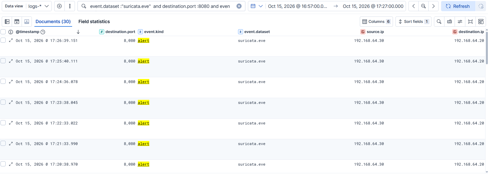
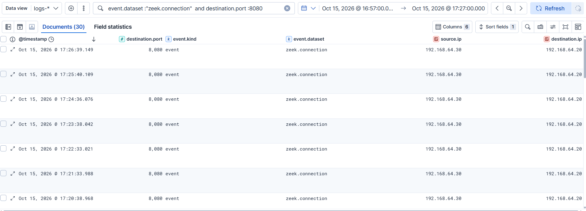
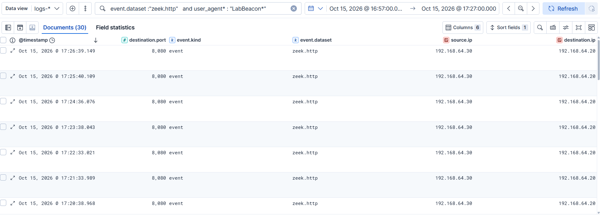
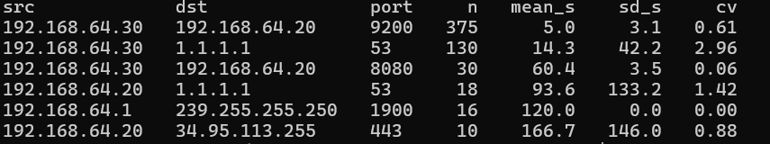
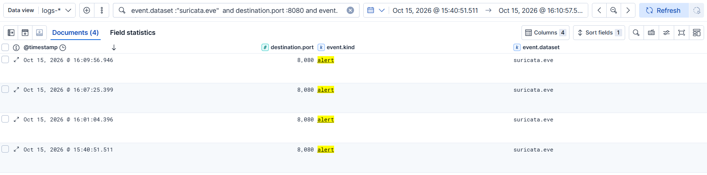
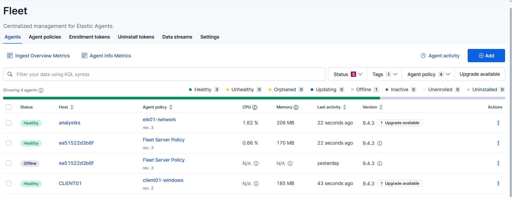

# Incident Report: T1071.001 Simulated C2 Beaconing

| | |
|---|---|
| **Report ID** | IR-2026-004 |
| **Date of activity** | 2026-10-15 |
| **Analyst** | Karthik S |
| **Host** | CLIENT01 (`192.168.64.30`), Windows 11 Enterprise, domain `lab.local`; listener and sensors on ELK01 (`192.168.64.20`) |
| **Source** | Controlled test: PowerShell/`curl.exe` loop, 30 requests at ~60 s with ±5 s jitter, fixed user agent `LabBeacon/1.0` |
| **Severity** | Medium (as a real beacon would be; this was test activity) |
| **Status** | Beacon half detected and written up. DNS tunnelling (T1071.004): **not started**. Sigma-to-Elastic conversion of the signature rule: **untested** (the Kibana query was tested directly) |

## 1. Summary

CLIENT01 sent 30 HTTP requests to a listener on ELK01 (`192.168.64.20:8080`) at roughly 60-second intervals with small jitter, simulating a low-sophistication command-and-control beacon (T1071.001). Both network sensors on ELK01, Suricata and Zeek, recorded all 30 flows, and a custom Suricata rule alerted on every one. A separate interval-regularity analysis of Zeek `conn.log` isolated the beacon from the other regular traffic in the lab. This was controlled test activity, not a live intrusion.

## 2. ATT&CK mapping

- **Tactic:** Command and Control (TA0011)
- **Technique:** T1071.001, Application Layer Protocol: Web Protocols

## 3. Timeline

All times UTC (Kibana displayed BST, UTC+1, in the screenshots; subtract one hour).

| Time (UTC) | Source | Event | Detail |
|---|---|---|---|
| 14:40:51 | Suricata | First single test request; alert `1000001` | Rule verified (my own test traffic) |
| 15:01:04, 15:07:25, 15:09:56 | Suricata / Zeek | Three further single test requests | My own traffic; the 15:09:56 flow was the first to log as `SF` after the checksum fix. Excluded from beacon statistics |
| 15:57:26 | Analyst | Beacon loop started on CLIENT01 | `Get-Date`: 16:57:26 BST |
| 15:57:26 to 16:26:39 | Suricata, Zeek | 30 requests to `192.168.64.20:8080` | 30 Suricata alerts, 30 `zeek.connection` rows, 30 `zeek.http` rows; the last beat (16:26:39) is logged by Suricata and Zeek 2 ms apart |
| 16:27:33 | Analyst | Loop finished | `Get-Date`: 17:27:33 BST |

## 4. Detection

**Telemetry sources:** Suricata (`eve.json`) and Zeek (`conn.log`, `http.log`) running on ELK01, shipped by an Elastic Agent on policy `elk01-network` into `logs-*`.

**Portfolio detections:**
- `detections/T1071-beaconing.yml`: Sigma rule for the user-agent signature, with the behavioural logic documented in its comments.
- `detections/suricata/T1071-beaconing.rules`: the native Suricata rule (`sid:1000001`).
- `detections/hunts/T1071-beacon-interval.py`: the interval-regularity hunt script.

**Validated queries (KQL, window 16:57-17:27 BST, 30 results each):**

```
event.dataset : "suricata.eve" and destination.port : 8080 and event.kind : "alert"
event.dataset : "zeek.connection" and destination.port : 8080
event.dataset : "zeek.http" and user_agent.original : "LabBeacon/1.0"
```

**Behavioural detection (hunt script over Zeek `conn.log`):** group connections by source, destination and destination port; for pairs with at least 10 connections compute the mean and population standard deviation of inter-arrival times; flag a coefficient of variation (sd / mean) below 0.2, excluding multicast destinations.

| Pair | n | mean (s) | sd (s) | cv | Identity |
|---|---|---|---|---|---|
| `192.168.64.30` to `192.168.64.20:8080` | 30 | 60.4 | 3.5 | **0.06** | simulated beacon |
| `192.168.64.1` to `239.255.255.250:1900` | 16 | 120.0 | 0.0 | 0.00 | SSDP discovery (likely the host's VMnet8 adapter; **not verified**) |
| `192.168.64.30` to `192.168.64.20:9200` | 375 | 5.0 | 3.1 | 0.61 | Elastic Agent data plane |
| `192.168.64.20` to `1.1.1.1:53` | 18 | 93.6 | 133.2 | 1.42 | DNS |
| `192.168.64.30` to `1.1.1.1:53` | 130 | 14.3 | 42.2 | 2.96 | DNS |
| `192.168.64.20` to `34.95.113.255:443` | 10 | 166.7 | 146.0 | 0.88 | not identified |

**Findings worth recording:**
- **The signature is the naive version.** Any operator who changes the user agent defeats the Suricata rule and the Zeek HTTP query. The interval analysis does not depend on it.
- **Low variance alone is not a detection.** The SSDP multicast traffic was more regular than the beacon (cv 0.00). A threshold-only rule would have flagged it first; the multicast exclusion and a minimum count are required.
- **The interval check is a hunt script, not a SIEM rule.** Sigma has no standard-deviation or inter-arrival aggregation, and the KQL used here cannot compute one. This is stated deliberately so the portfolio does not imply an in-SIEM detection that does not exist.
- **The 0.2 threshold is supported, not proven.** It rests on one beacon and five baseline pairs. Higher-jitter beacons need a looser threshold and will cost more false positives.
- **Internal destinations were not excluded** because the listener is on the internal network. A production rule would concentrate on external destinations.
- **The Sigma rule uses Zeek's native field name** (`user_agent`); in Elastic the field is `user_agent.original`. No sigma-cli conversion has been run, so the mapping is unverified. The Kibana query above is what was tested.
- **The sensor saw traffic ELK01 was not party to** (CLIENT01 to `173.46.83.203:80` and to `1.1.1.1:53`), confirmed with `tcpdump` on `ens33`. VMnet8 delivers other VMs' traffic to ELK01, so this sensor placement works on this setup. CLIENT01 to DC01 traffic was **not** tested.
- **Sensor gotcha (Zeek on a VMware guest):** flows from ELK01 itself were logged with `conn_state` `SH`/`OTH`, one reply packet and `resp_bytes: 0`, because of NIC checksum offload. The `history` field showed lowercase/uppercase `c`. `redef ignore_checksums = T;` fixed it (after: `SF`, `resp_bytes: 202`, 5 packets each way). A `grep` for `bad_checksum` returned 0 because Zeek names these weirds by protocol; the fix was judged by the before/after rows, and I did not capture the `weird.log` entries. This is a deliberate lab trade-off.
- **Unexplained:** before the run, Kibana showed 1 `zeek.connection` row for `:8080` against 4 Suricata alerts. The run itself matched 30 to 30. Cause not established.

## 5. IOCs

> Lab/test artifacts from a controlled simulation.

- **Source:** CLIENT01, `192.168.64.30`
- **Destination:** `192.168.64.20:8080/tcp` (ELK01 listener, Python `http.server`)
- **User agent:** `LabBeacon/1.0`
- **Path:** `/beacon`
- **Behaviour:** ~60 s interval, ±5 s jitter, 30 requests over about 30 minutes
- **Not captured:** the process on CLIENT01 that made the requests (see section 7)

## 6. False-positive analysis

- **Regular benign traffic exists and some of it is more regular than a beacon.** SSDP multicast (cv 0.00) is the clearest example. Tuning: require at least 10 connections, apply the cv threshold, exclude multicast (224.0.0.0/4).
- **Agent and DNS traffic scored far above the threshold** (cv 0.61 to 2.96), so they do not trigger. That is a statement about this lab's traffic, not a guarantee.
- **Real estates add more periodic traffic:** NTP, update checks, EDR and monitoring agents, and software with fixed polling. An allowlist of known-benign destinations is needed before alerting, and the baseline must be built per environment.
- **Signature rule:** low false-positive risk in this lab, but also low value: it only catches this exact string.
- **Not tested:** longer windows, beacons with higher jitter, beacons over HTTPS (the HTTP signature would not see the user agent at all; the interval analysis would still apply to the connection metadata).

## 7. Containment & remediation

In a real incident an analyst would:

- **Identify the process** on CLIENT01 making the connections (Sysmon process and network events, parent chain) and preserve it.
- **Isolate the host** and **block the destination** at the firewall; check whether other hosts talk to the same destination or use the same user agent.
- **Scope the intrusion:** how the beacon got there (initial access, persistence such as the scheduled-task and account techniques in IR-2026-002 and IR-2026-003), and which accounts were active on the host.
- **Reset credentials** used on the host if compromise is confirmed.
- **Preventive hardening:** egress filtering and proxying so that unexpected destinations are blocked or logged, and continued collection of both host and network telemetry.

## 8. Evidence

**Suricata alerts for the beacon run** (30 results, source and destination visible):



**Zeek connection rows for the same flows** (30 results):



**Zeek HTTP rows matching the user agent** (30 results):



**Interval statistics across all pairs with at least 10 connections:**



**First single test request, rule verification:**



**Sensor policy healthy in Fleet:**



> Image names and extensions assumed (`.png`); confirm exact filenames before linking. Crop the enrollment token out of any Fleet screenshot.

---
*Behavioural half of this detection is a hunt script; DNS tunnelling (T1071.004) will be added to this report or a separate IR once tested.*
