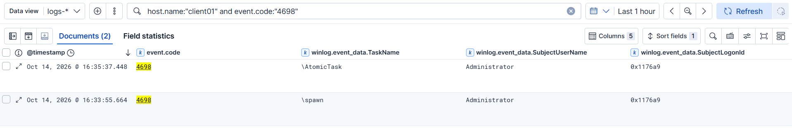
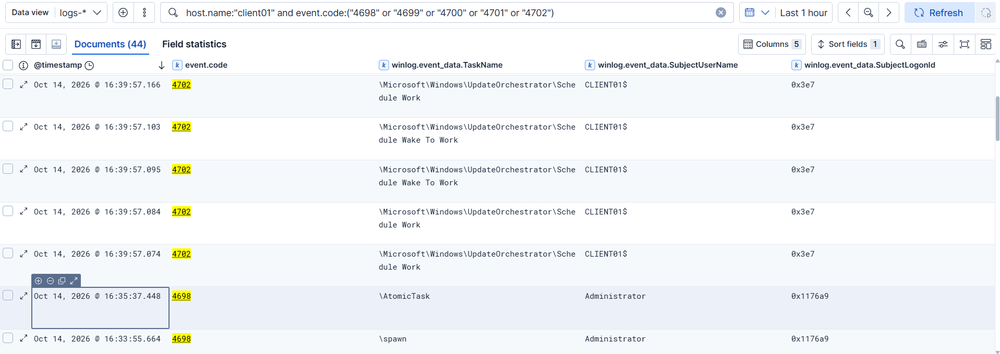
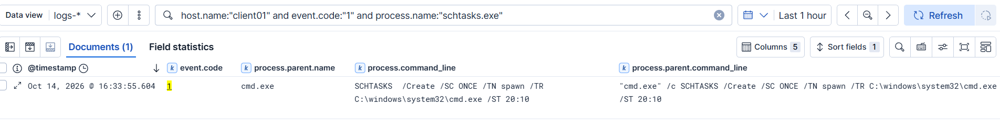
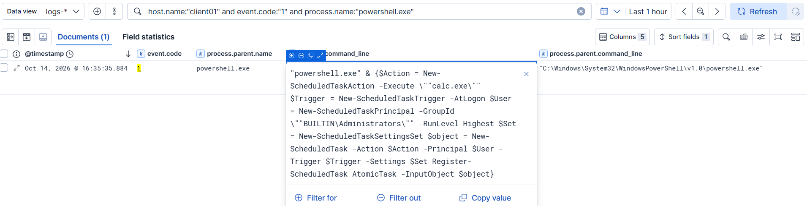
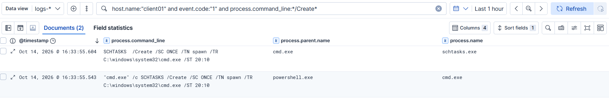
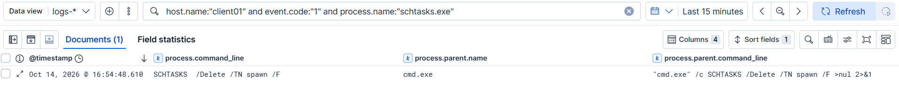
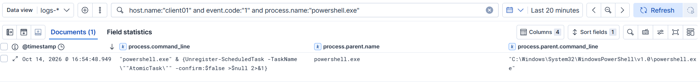
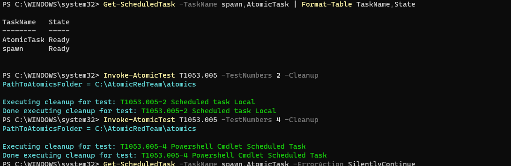

# Incident Report: T1053.005 Scheduled Task Persistence

| | |
|---|---|
| **Report ID** | IR-2026-003 |
| **Date of activity** | 2026-10-14 |
| **Analyst** | Karthik S |
| **Host** | CLIENT01 (`192.168.64.30`), Windows 11 Enterprise, domain `lab.local` |
| **Source** | Controlled test, Atomic Red Team T1053.005 tests 2 (`schtasks.exe`) and 4 (PowerShell cmdlet) |
| **Severity** | Medium |
| **Status** | Detected, cleaned up; process-rule Elastic query re-test pending (see section 4) |

## 1. Summary

Two scheduled tasks were created on **CLIENT01** by `Administrator` within two minutes (T1053.005), generated by Atomic Red Team: `\spawn` via `schtasks.exe /Create` and `\AtomicTask` via the PowerShell `Register-ScheduledTask` cmdlet. Windows Security **4698** fired for both. Sysmon showed `schtasks.exe` for the first only; the second was visible solely as a PowerShell process whose command line happened to carry the cmdlet. Neither task ran during the test, and both were deleted about 20 minutes later. This was controlled test activity, not a live intrusion.

## 2. ATT&CK mapping

- **Tactics:** Execution (TA0002), Persistence (TA0003), Privilege Escalation (TA0004)
- **Technique:** T1053.005, Scheduled Task/Job: Scheduled Task

## 3. Timeline (as seen in Kibana Discover, `logs-*`)

All times UTC (Kibana displayed BST, UTC+1, in the screenshots; subtract one hour). All Security events share `SubjectUserName` `Administrator` and `SubjectLogonId` `0x1176a9`, the same logon session as IR-2026-002.

| Time (UTC) | Source | Event | Detail |
|---|---|---|---|
| 15:32:46 | Analyst | Baseline `Get-Date` and `Get-ScheduledTask -TaskName spawn,AtomicTask` | No tasks returned |
| 15:33:55.543 | Sysmon EID 1 | `cmd.exe /c SCHTASKS /Create …`, parent `powershell.exe` | Wrapper process launched by the atomic runner |
| 15:33:55.604 | Sysmon EID 1 | `SCHTASKS  /Create /SC ONCE /TN spawn /TR C:\windows\system32\cmd.exe /ST 20:10` | Parent `cmd.exe`. Note the double space after `SCHTASKS` |
| 15:33:55.664 | Security 4698 | Task `\spawn` created | 60 ms after the `schtasks.exe` process event |
| 15:35:30.886 | Analyst | Test 4 started (`Get-Date` before the run) | |
| 15:35:35.884 | Sysmon EID 1 | `powershell.exe & {$Action = New-ScheduledTaskAction -Execute "calc.exe" … Register-ScheduledTask AtomicTask -InputObject $object}` | Parent `powershell.exe`. **No `schtasks.exe`** |
| 15:35:37.448 | Security 4698 | Task `\AtomicTask` created | About 1.6 s after the PowerShell process |
| 15:39:57.074 to .166 | Security 4702 | Task-updated events by `CLIENT01$` (`0x3e7`, SYSTEM) on `\Microsoft\Windows\UpdateOrchestrator\Schedule Work` and `Schedule Wake To Work` | **Unrelated Windows noise** |
| 15:54:48.610 | Sysmon EID 1 | `SCHTASKS  /Delete /TN spawn /F`, parent `cmd.exe /c … >nul 2>&1` | Atomic cleanup |
| 15:54:48.653 | Security 4699 | Task deleted | 43 ms after the `/Delete`; attributed to `\spawn` by timing (TaskName column was not shown) |
| 15:54:48.949 | Sysmon EID 1 | `powershell.exe & {Unregister-ScheduledTask -TaskName "AtomicTask" -confirm:$false >$null 2>&1}` | Atomic cleanup |
| 15:54:50.211 | Security 4699 | Task deleted | About 1.3 s later; attributed to `\AtomicTask` by timing |

Neither task executed: `\spawn` was set to run once at 20:10 local time and `\AtomicTask` triggers at logon. Both showed state `Ready` before cleanup. After cleanup, `Get-ScheduledTask -TaskName spawn,AtomicTask` returned nothing (terminal screenshot in section 8).

## 4. Detection

**Telemetry sources:** Windows Security EID 4698 (primary) and Sysmon EID 1 (context), shipped by Elastic Agent into `logs-*`. 4698 is only written because the `Other Object Access Events` audit subcategory was enabled before the test.

**Portfolio detections (Sigma):**
- `detections/T1053.005-scheduled-task-created-4698.yml`: any `4698`. Covers both routes.
- `detections/T1053.005-schtasks-create-process.yml`: `schtasks.exe` with `/create` (or `-create`) in the command line. Adds task name, action, trigger, parent and actor.

**Validated hunts (KQL):**

```
host.name:"client01" and event.code:"4698"
host.name:"client01" and event.code:"1" and process.name:"schtasks.exe"
host.name:"client01" and event.code:"1" and process.name:"powershell.exe"
host.name:"client01" and event.code:"4699"
```

Why two rules: a Sysmon `schtasks /create` rule alone is blind to the cmdlet route, which produced no `schtasks.exe` process (the `schtasks.exe` hunt returned exactly one event, for test 2). Security 4698 fired for both, so it is the primary rule and the process rule is corroboration.

**Findings worth recording:**
- **4698 carries no process or command line.** Link it to the process event by `SubjectLogonId` and time.
- **The PowerShell event caught test 4 only because the atomic passes its script inline.** The same task registered from a `.ps1` file or an interactive session would not put `Register-ScheduledTask` on the command line. Script Block Logging (4104) is not collected by the current `client01-windows` policy, which is a coverage gap.
- **Task content** (4698 `TaskContent` XML for `\AtomicTask`): `LogonTrigger` enabled; principal group `S-1-5-32-544` (Administrators) with `HighestAvailable`; action `calc.exe`; `Hidden` false; `ExecutionTimeLimit` PT72H. A logon-triggered task that runs elevated for any administrator logon. Test 2's `TaskContent` was not captured.
- **ART test 4's description does not match its command.** The text says it spawns `cmd.exe` at 20:10; the command registers `calc.exe` at logon.
- **A converted rule query can silently fail on case.** Sigma's `contains` is case-insensitive, but the Lucene conversion of the process rule is case-sensitive on `process.command_line`. Searched as `*/create*` it returned nothing; as `*/Create*` it returned two events (the `cmd.exe` wrapper and `schtasks.exe`). The rule should be converted with the EQL backend, whose `like~` operator is case-insensitive. Re-test of that converted query in Kibana: pending.
- **Command-line matches return two events per execution** (the `cmd.exe /c` wrapper and `schtasks.exe`); matching on the image avoids the duplicate.

## 5. IOCs

> Lab/test artifacts from a controlled atomic.

- **Task names:** `\spawn` (action `C:\windows\system32\cmd.exe`, one-time trigger 20:10 local), `\AtomicTask` (action `calc.exe`, logon trigger, Administrators, highest run level)
- **Actor / session:** `Administrator`, logon ID `0x1176a9` (domain not captured)
- **Host:** CLIENT01 / `192.168.64.30`
- **Commands:** `SCHTASKS /Create /SC ONCE /TN spawn /TR C:\windows\system32\cmd.exe /ST 20:10`; `Register-ScheduledTask AtomicTask -InputObject $object`
- **Forensic note:** the cleanup commands redirect output to null, so the process events are the only trace of the deletion arguments.

## 6. False-positive analysis

- **`4698` is routine on busy hosts.** Installers, browser and EDR updaters, and backup tooling register tasks. In this lab only two `4698` events appeared in an hour, so there is no real noise baseline yet. Baseline by host role, creating account and task path before alerting.
- **`schtasks.exe /create` is used by admin scripts and deployment tools.** Triage by parent process, the executing account and whether a matching `4698` follows.
- **Do not alert on `4702`.** The Update Orchestrator produced a burst of them from SYSTEM minutes after the test, unrelated to any attack.
- **Tuning applied:**
  - The process rule matches `/create` as a single token with `contains`, rather than a literal `SCHTASKS /Create`, because the command was logged uppercase with a double space.
  - Process-only coverage missed `Register-ScheduledTask`, which is why `4698` is the primary rule.
  - Not yet tested: whether `schtasks` accepts `-create` or an abbreviation such as `/cr`. The rule allows `-create` only.
- **Candidate tuning, not validated:** exclude `\Microsoft\Windows\*` tasks created by a machine account. An attacker running as SYSTEM can name a task under that path, so the exclusion is a trade-off.
- **Cleanup noise:** atomic cleanup produces two `4699` events, a `schtasks /Delete` and an `Unregister-ScheduledTask` process. These are not attacker activity and `/Delete` does not match the rule.

## 7. Containment & remediation

In a real incident an analyst would:

- **Export, then disable and delete** the task (`Export-ScheduledTask` first, to preserve the action, trigger and principal as evidence).
- **Investigate the creator:** logon session `0x1176a9` and the `Administrator` account. Find how that session was established, and reset its credentials if compromise is suspected.
- **Inspect the action:** path, hash, signer and whether the binary or script still exists. A task pointing into `%TEMP%`, `AppData` or `Downloads` is a stronger signal than the task itself.
- **Scope:** hunt the same task name and action across other endpoints, and look for other persistence from the same session (Run keys, services, WMI subscriptions).
- **Preventive hardening:** collect PowerShell Script Block Logging (4104), restrict who can register tasks, and alert on `4698` outside change windows.

## 8. Evidence

**Task creation, both routes** (`4698` for `\spawn` and `\AtomicTask`, same actor and logon session):



**Task lifecycle query** (`4698`/`4699`/`4700`/`4701`/`4702`; the visible `4702` rows are Update Orchestrator noise from SYSTEM):



**Process creation, `schtasks /Create`, test 2** (one event; the cmdlet route produced none):



**Process creation, PowerShell route, test 4** (`Register-ScheduledTask` visible only because the atomic passes the script inline):



**Case-sensitivity test** (`*/Create*` returns the `cmd.exe` wrapper and `schtasks.exe`; `*/create*` returned nothing):



**Cleanup, `schtasks /Delete`, test 2:**



**Cleanup, `Unregister-ScheduledTask`, test 4:**



**Cleanup run and confirmation** (both tasks `Ready` beforehand, cleanup for tests 2 and 4, final `Get-ScheduledTask` returns nothing):



---
*Detections authored in Sigma for portability.*
