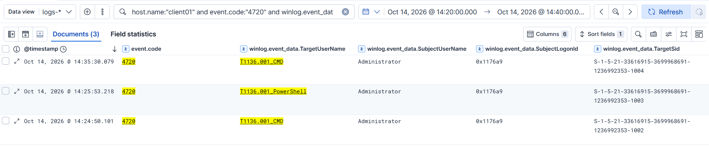
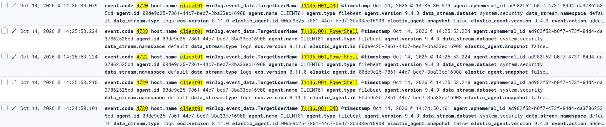
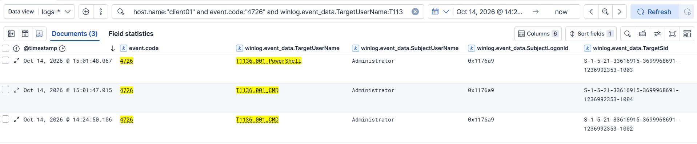
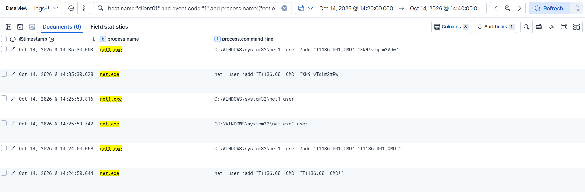

# Incident Report: T1136.001 Local Account Creation

| | |
|---|---|
| **Report ID** | IR-2026-002 |
| **Date of activity** | 2026-10-14 |
| **Analyst** | Karthik S |
| **Host** | CLIENT01 (`192.168.64.30`), Windows 11 Enterprise, domain `lab.local` (DC01 offline during test) |
| **Source** | Controlled test, Atomic Red Team T1136.001 tests 4 (cmd) and 5 (PowerShell) |
| **Severity** | Medium |
| **Status** | Detected, tuned, closed |

## 1. Summary

Three local-account creation attempts were made on **CLIENT01** by `Administrator` (T1136.001), generated by Atomic Red Team: one `net user /add` rejected by the password policy, one `New-LocalUser -NoPassword`, and a corrected `net user /add` re-run. All three were visible in the Security log; only the two `net user` attempts were visible as processes in Sysmon. This was controlled test activity, not a live intrusion.

## 2. ATT&CK mapping

- **Tactic:** Persistence (TA0003)
- **Technique:** T1136.001, Create Account: Local Account

## 3. Timeline (as seen in Kibana Discover, `logs-*`)

All times UTC (Kibana displayed BST, UTC+1, in the screenshots; subtract one hour). All Security events share `SubjectUserName` `Administrator` and `SubjectLogonId` `0x1176a9`, i.e. one logon session.

| Time (UTC) | Source | Event | Detail |
|---|---|---|---|
| 13:24:50.044 | Sysmon EID 1 | `cmd.exe` → `net  user /add "T1136.001_CMD" "T1136.001_CMD!"` | Atomic default password contains the username, so it fails complexity |
| 13:24:50.068 | Sysmon EID 1 | `net1.exe` child of `net.exe` | Same arguments |
| 13:24:50.101 | Security 4720 | Account `T1136.001_CMD` created | SID RID 1002. **No 4722/4738/4724 follow** |
| 13:24:50.106 | Security 4726 | Account `T1136.001_CMD` deleted | 5 ms after creation: automatic rollback of the failed attempt |
| 13:25:53.218 | Security 4720 | Account `T1136.001_PowerShell` created | `New-LocalUser -NoPassword`; RID 1003 |
| 13:25:53.224 | Security 4722, 4738 | Account enabled, account changed | **No 4724**: no password was set |
| 13:25:53.742 / .816 | Sysmon EID 1 | `net user` (no `/add`), parent `powershell.exe` | Analyst's own verification listing. Not attacker activity |
| 13:35:30.028 / .053 | Sysmon EID 1 | `net  user /add "T1136.001_CMD" "Xk9!vTqLm2#Rw"`, then `net1.exe` child | Re-run with `-InputArgs` and a compliant password |
| 13:35:30.079 | Security 4720 | Account `T1136.001_CMD` created | RID 1004 |
| 13:35:30.109 / .110 | Security 4722, 4738, 4724 | Enabled, changed, **password reset** | `4724` appears only on the `net user` route |
| 14:01:47.015 | Security 4726 | `T1136.001_CMD` deleted | Atomic cleanup |
| 14:01:48.067 | Security 4726 | `T1136.001_PowerShell` deleted | Atomic cleanup |

No Sysmon `net.exe /add` process exists for the PowerShell test: the only `net.exe` near 13:25:53 is the verification listing above.

## 4. Detection

**Telemetry sources:** Windows Security EID 4720 (primary) and Sysmon EID 1 (context), shipped by Elastic Agent into `logs-*`.

**Portfolio detections (Sigma):**
- `detections/T1136.001-local-account-created-4720.yml`: any non-machine `4720`. Covers `net user`, `New-LocalUser` and failed attempts.
- `detections/T1136.001-net-user-add-process.yml`: `net.exe`/`net1.exe` with `user` and `/add` (or `/ad`) in the command line, order-independent, whitespace-tolerant. Adds the actor, parent and cleartext password.

**Validated hunts (KQL):**

```
host.name:"client01" and event.code:"4720" and winlog.event_data.TargetUserName:T1136.001*
host.name:"client01" and event.code:"1" and process.name:("net.exe" or "net1.exe")
host.name:"client01" and event.code:"4726" and winlog.event_data.TargetUserName:T1136.001*
```

Why two rules: a Sysmon `net … /add` rule alone is blind to the PowerShell route, which produced no `net.exe`. A rule requiring the full `4720 → 4722 → 4738` chain would miss the failed attempt, which produced only `4720` then `4726`. Alerting on `4720` alone covers all three cases.

## 5. IOCs

> Lab/test artifacts from a controlled atomic.

- **Accounts created:** `T1136.001_CMD` (RIDs 1002 failed/rolled back, 1004 re-run), `T1136.001_PowerShell` (RID 1003). Domain SID prefix `S-1-5-21-33616915-3699968691-1236992353`.
- **Actor / session:** `Administrator`, logon ID `0x1176a9`
- **Host:** CLIENT01 / `192.168.64.30`
- **Commands:** `net user /add "T1136.001_CMD" "T1136.001_CMD!"`; `net user /add "T1136.001_CMD" "Xk9!vTqLm2#Rw"`; `New-LocalUser -Name "T1136.001_PowerShell" -NoPassword`
- **Credentials exposed in logs:** `T1136.001_CMD!` and `Xk9!vTqLm2#Rw` (lab-only), readable in `process.command_line`
- **Forensic note:** the rolled-back account consumed RID 1002, so a gap in RID sequence can reveal attempts whose accounts no longer exist.

## 6. False-positive analysis

- **`4720` is routine in some estates.** Provisioning scripts, imaging and onboarding tooling create accounts legitimately. On a domain controller the event covers every new domain account, so baseline by host role, change window and a named provisioning account. Machine accounts ending in `$` are filtered out.
- **`net user /add` is used by admin scripts and deployment tools.** Triage by parent process, the executing account and whether a matching `4720` follows. Expect two process events per execution (`net.exe` and its `net1.exe` child).
- **Tuning applied:**
  - The process rule matches `user` and `/add` as separate terms with `\s` tolerance instead of a literal `net user /add`. cmd.exe-launched commands were logged with a double space (`net  user /add`), unlike the plain listing (`net user`), so a literal string match would be fragile.
  - Process-only coverage missed `New-LocalUser`, which is why `4720` is the primary rule.
  - Not yet tested: whether `net` accepts the shortened `/ad` switch. The regex allows it in case it does.
- **Cleanup noise:** atomic cleanup produces `4726` events and a `net user /del` process. These are not attacker activity and `/del` does not match the rule.

## 7. Containment & remediation

In a real incident an analyst would:

- **Disable and delete** the new account, then check whether it was added to any group (`4732` was absent here) and whether it logged on.
- **Investigate the creator:** logon session `0x1176a9` and the `Administrator` account. Find how that session was established, and reset its credentials if compromise is suspected.
- **Treat exposed passwords as compromised.** Anyone able to read Sysmon/process-creation telemetry can read the cleartext password of a `net user /add`. Restrict access to that data and avoid passing passwords on command lines.
- **Scope:** hunt `4720` and `net user /add` across other endpoints; a failed attempt (`4720` followed quickly by `4726`) suggests someone probing the password policy.
- **Preventive hardening:** restrict local administrator rights, deploy LAPS, and alert on `4720` on workstations and member servers outside change windows.

## 8. Evidence

**Account creation events with actor and logon session** (`4720` ×3):



**Account lifecycle, part 1** (PowerShell route: `4720`, `4722`, `4738`, no `4724`):


**Account lifecycle, part 2** (`net user` route: `4724` password reset):



**Rollback and cleanup** (`4726` at 14:24:50 BST and the two cleanup deletions):



**Process creation** (`net user /add` with command lines; the 14:25:53 `net user` is the verification listing):



---
*Detections authored in Sigma for portability.*
